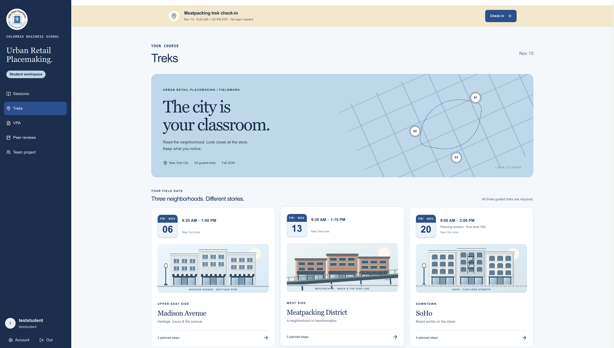
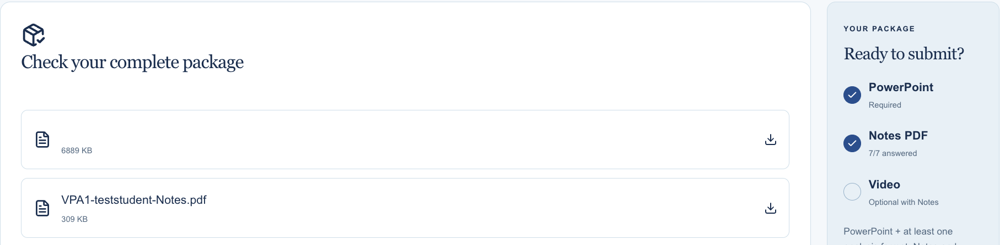
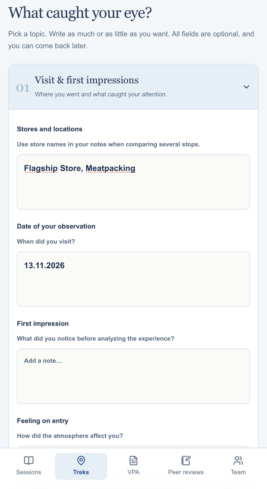

# Urban Retail Placemaking: Course Platform

A full-stack web app built for Urban Retail Placemaking, an MBA elective at Columbia Business School (Fall 2026). Students use it to follow the course, take structured notes on field treks around New York City, prepare and submit assignments, and run peer reviews. The teaching team uses it to track progress across the class.



> **About this repository:** this is a public showcase copy. Course content (frameworks, assignment briefs, trek partners, guest speakers), student data, credentials and production infrastructure have been removed or replaced with sample content. The live app is private to the class.

## Why I built it

Urban Retail Placemaking is a Columbia Business School elective where MBA students learn retail strategy by walking New York's shopping districts and analyzing what they see. Before this, the course ran entirely on Canvas, which handles files and grades but not fieldwork, peer review or team projects. An earlier trek app saw little use, and the course had never had a dedicated platform. With Jack Chen, my fellow TA, I built one course workspace that works on a laptop in class and on a phone in the store: session prep, field treks, assignments, peer review and team projects. Canvas stays the official record, and the platform reads from it.

## Impact (Fall 2026)

- Rolled out to all 40 enrolled students and the teaching team as the course's first dedicated platform, with each student's status across 11 Canvas assignments synced automatically
- Moved fieldwork onto students' phones for 3 field treks: itineraries with maps, a frameworks reference, trek check-in, and a private notebook with photos, so observations are captured in the store
- Connected fieldwork to grading: students import their trek notes into their assignment, and a checklist flags what's missing before they submit
- Ran anonymous, rubric-based peer reviews and gave 7 student teams a shared workspace for files, milestones and deliverable status
- Built direct submission to Canvas and verified it end-to-end on a test assignment before switching it on for the live class
- Cut load times for reviews and assignments by about 85%, from roughly 2.2 seconds to 0.3

## Screenshots

**Assignment builder:** students assemble their package and see what's still missing before they submit.



**Field notebook on a phone:** structured, cloud-saved notes captured in the store during a trek.



## Architecture

| Layer | Technology |
| --- | --- |
| Frontend | React 19, Next.js-style app router (Vinext), Tailwind, shadcn/ui |
| API | Serverless worker (`app/api/[...path]/route.ts`, `lib/`) |
| Data | SQLite on Cloudflare D1 via Drizzle ORM (`db/`, `drizzle/`) |
| Files | Private object storage (R2) for uploads, generated PDFs and backups |
| Integrations | Canvas LMS through a server-side relay; optional AI analysis for staff |

Security basics: hashed passwords, HttpOnly session cookies, server-side permission checks on every request, origin validation on writes, and separate data partitions for live, demo and sandbox courses.

More detail in [docs/ARCHITECTURE.md](docs/ARCHITECTURE.md).

## Running it locally

Requires Node 24 LTS.

```sh
npm run install:ci
npm run build
node scripts/setup-local.mjs
npm start
```

`setup-local.mjs` creates a local admin account (`owner01`) and writes a generated password to `.dev.vars`, which is git-ignored. The local database starts empty. Canvas and AI features stay off unless you provide your own credentials. See [docs/LOCAL_DEVELOPMENT.md](docs/LOCAL_DEVELOPMENT.md).

## Tests

Unit and integration tests live in `scripts/` (for example `node scripts/trek-tests.mjs`, `node scripts/vpa-tests.mjs`). CI runs the build and test suite via `.github/workflows/validate.yml`.
